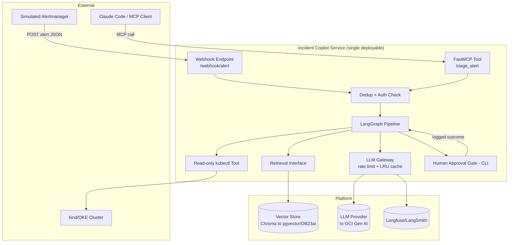
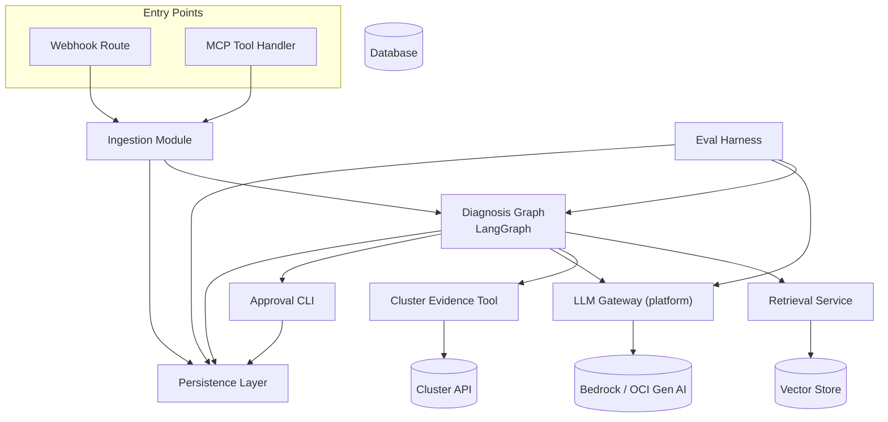
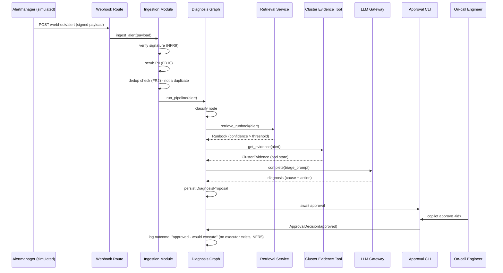

# Incident Copilot (M1) Architecture Document

## Introduction

This document outlines the overall project architecture for Incident Copilot (M1), including backend systems, shared platform services, and non-UI concerns. Its primary goal is to serve as the guiding architectural blueprint for AI-driven development, ensuring consistency and adherence to chosen patterns and technologies — and, per the PRD's framing, to lay down the platform (gateway, eval harness, deploy pipeline) that M2–M6 reuse.

**Relationship to Frontend Architecture:** Not applicable. Per the PRD, MVP interaction is CLI-only; there is no significant UI, so no separate Frontend Architecture Document is produced.

### Starter Template or Existing Project

Greenfield project. No starter template or existing codebase is referenced in the PRD or RFC. Proceeding with architecture design from scratch — manual setup required for all tooling and configuration (FastAPI project layout, CI workflow, Dockerfile, Terraform modules). **N/A beyond this note.**

### Change Log

| Date | Version | Description | Author |
|---|---|---|---|
| 2026-11-04 | 0.1 | Initial architecture draft for M1 Incident Copilot, derived from PRD + RFC | Winston (Architect) |

## High Level Architecture

### Technical Summary

Incident Copilot is a modular-monolith Python/FastAPI service orchestrating a LangGraph state machine (classify → retrieve → investigate → propose → human-approval) that turns a simulated Prometheus alert into an evidence-grounded diagnosis, gated behind explicit human approval. All model calls route through one internal LLM Gateway (rate-limited, cached) and all vector retrieval routes through one Retrieval interface — both are deliberately thin seams so Epic 5 can swap providers (OCI Gen AI, Oracle DB 23ai) behind them without touching call sites. The service is containerized and deployed via GitOps (Terraform + ArgoCD) to a real cluster, with every LLM call traced and a CI-gated eval harness enforcing a quality floor. This directly supports the PRD's dual goal: a trustworthy, demoable incident-diagnosis product, and a reusable platform (gateway, eval harness, deploy template) for the five products that follow it.

### High Level Overview

1. **Architectural style:** Modular Monolith, LangGraph-orchestrated (per PRD Technical Assumptions) — one deployable unit, internally organized into clearly-seamed modules (gateway, retrieval, graph, tools, approval) rather than separate network services.
2. **Repository structure:** Monorepo (per PRD) — `apps/incident-copilot/` for product code, `platform/` for the gateway/tracing/deploy pieces meant for reuse by M2–M6, `docs/` for BMad artifacts.
3. **Service architecture:** Single FastAPI process exposing two entry points (HTTP webhook, FastMCP tool) that both call into the same LangGraph pipeline — no duplicated business logic between transports (PRD Story 5.2 AC1).
4. **Primary data flow:** `Alert (webhook or MCP) → dedup/auth check → classify node → retrieve node (vector search) → investigate node (read-only kubectl) → propose node (LLM call via gateway) → human-approval node (CLI) → logged outcome`. Every node transition is logged for replay (PRD Story 2.2 AC4).
5. **Key decisions and rationale:**
   - **Single gateway/retrieval seams (NFR1/NFR8):** chosen specifically because Epic 5 must prove these abstractions hold under a real provider swap — this is a testable architectural commitment, not just good taste.
   - **No action-executor module exists at all (NFR5):** the human-approval node's "approve" path has no code path to a mutating action — there is nothing to bypass, because there is nothing to call. This satisfies "no autofix" architecturally, not just via a UI gate.
   - **CLI as the approval transport for MVP:** avoids taking on a Slack/Telegram integration (explicitly deferred) before the core loop is proven.

### High Level Project Diagram



### Architectural and Design Patterns

- **Gateway Pattern (LLM Gateway):** A single internal module mediates every call to an LLM provider, applying rate limiting and caching uniformly. *Rationale:* directly required by NFR1; it's also the exact seam Epic 5's provider swap tests, and the seam M2–M6 will depend on as a shared platform piece.
- **Repository Pattern (Retrieval Interface):** Vector store access goes through one interface, never called ad hoc. *Rationale:* required by NFR8; makes the Chroma→pgvector/DB23ai migration (Story 5.1) a swap of one implementation, not a grep-and-replace across the codebase.
- **State Machine / Orchestrator (LangGraph):** The diagnosis pipeline is an explicit graph of nodes with inspectable state, not a single function with branching logic. *Rationale:* required by PRD Story 2.2; makes each stage unit-testable and the whole run replayable from logs.
- **Hexagonal-lite boundary around external I/O:** `kubectl` calls, LLM calls, and vector store calls are each isolated behind their own module boundary (tool/gateway/retrieval), with the graph nodes depending on interfaces, not concrete clients. *Rationale:* this is what makes NFR1/NFR8/NFR5 enforceable by code structure rather than by convention alone.

I considered and rejected **Event-Driven (pub/sub) decomposition** for M1 — queueing alerts through SQS/EventBridge-equivalent before processing. That pattern is explicitly scheduled for **M2 (PipelineMedic, Story P3)** where async webhook processing is a named requirement; introducing it here would be solving a scale problem M1 doesn't have yet (single alert, single pipeline run, synchronous human approval) — Progressive Complexity, per the RFC's own stated philosophy.

---

**⚠️ Elicitation required before continuing.**

Rationale / flags:
- The diagram shows MCP and webhook both landing on the same Dedup+Auth check — worth confirming you want NFR9's signature verification applied to the MCP path too, or only the HTTP webhook (RFC/PRD are written assuming HTTP webhook auth; MCP auth semantics differ by transport, so this may need its own answer in the Security section later).
- "No action-executor module exists at all" is my strongest architectural interpretation of NFR5 — it means Epic 5/M2+ can't casually add real remediation without a deliberate new epic and a new PRD/architecture decision, which is intentional friction.

Select 1-9 or just type your question/feedback:

1. Proceed to next section (Tech Stack)
2. Expand on MCP-path authentication — should it mirror HMAC or use a different mechanism
3. Challenge from a different stakeholder's perspective (e.g., a security reviewer auditing both entry points)
4. Analyze what could go wrong with "no action-executor exists" once M2 reuses this agent core and does need to post PR comments (a real write action)
5. Identify hidden assumptions in treating webhook and MCP as symmetric entry points
6. Red Team: argue for an event-driven queue now, since 5 more products are coming and will need it anyway
7. Tree of Thoughts: 3 alternative high-level diagrams, compared
8. Self-Consistency check: re-derive the architectural patterns independently from the PRD's Technical Assumptions and diff
9. Meta-review: critique this section as if you were Dev about to implement the LangGraph skeleton (Story 2.2)

## Tech Stack

### Cloud Infrastructure

- **Provider:** Oracle Cloud Infrastructure (OKE) for compute/deploy; **Amazon Web Services (Bedrock)** for the LLM provider during S1–S12 only.
- **Key Services:** OCI Kubernetes Engine (OKE), AWS Bedrock Converse API (Nova Micro / Claude Haiku), swapping to OCI Gen AI + Oracle DB 23ai at Story 5.1 (S13).
- **Deployment Regions:** Single region for MVP (no multi-region requirement per PRD NFR6).

**This is a deliberate two-cloud split, not an oversight:** deploy infrastructure targets OCI (matching the RFC's stated OCI-native direction and the S13 migration target), while the LLM provider for S1–S12 is AWS Bedrock specifically because the AWS AIP-C01 cert labs (G1–G5 on `☁ AWS Labs`) require hands-on Bedrock Converse API usage mapped directly to this product. The LLM Gateway module (NFR1) is exactly what makes this tolerable — swapping Bedrock → OCI Gen AI at S13 is a provider-adapter change inside the gateway, not a re-architecture.

### Technology Stack Table

| Category | Technology | Version | Purpose | Rationale |
|---|---|---|---|---|
| **Language** | Python | 3.12 | Primary language | Modern, widely supported; satisfies PRD's "3.11+" with headroom |
| **Package manager** | uv | 0.9.x | Dependency management, lockfile | Fast, reproducible installs; generates a committed lockfile for the "no manual kubectl apply"-grade reproducibility bar this program sets everywhere |
| **Web framework** | FastAPI | 0.136.3 | Webhook HTTP API | Verified current as of 2026-11-04; per PRD Technical Assumptions |
| **ASGI server** | Uvicorn | 0.34.x | Serves FastAPI app | Standard FastAPI pairing |
| **Agent orchestration** | LangGraph | 1.2.14 | Diagnosis state machine | Verified current as of 2026-11-04; per PRD/RFC |
| **Vector store (MVP)** | Chromadb | 1.5.8 | Runbook retrieval (Story 1.3) | Verified current; per PRD — swapped to Oracle DB 23ai at Story 5.1 behind the Retrieval interface |
| **LLM provider SDK** | boto3 | 1.43.100 | AWS Bedrock Converse calls | Verified current; only module allowed to import this (NFR1) |
| **Kubernetes client** | kubernetes (official Python client) | 31.x | Read-only `get`/`describe` calls (Story 2.3) | Chosen over shelling out to the `kubectl` binary — typed responses, testable with a mock API client, and no risk of a shell-injection surface on alert-derived input |
| **MCP server** | fastmcp | 2.9.1 | Exposes `triage_alert` tool (Story 5.2) | Confirmed present on PyPI; **flagging low confidence on "latest"** — FastMCP's versioning was inconsistent across sources I checked. Re-verify at Story 5.2 implementation time before locking the lockfile. |
| **Config/secrets** | pydantic-settings | 2.7.x | Typed env-based config | Keeps NFR7 (no hardcoded secrets) enforceable via one settings module, not scattered `os.environ` calls |
| **Tracing** | Langfuse | 2.x (self-hosted or cloud) | LLM call tracing, cost-per-incident (Story 4.1) | Open-source option avoids a second paid SaaS dependency beyond Bedrock itself |
| **Linting** | ruff | 0.8.x | Lint + format | Single fast tool replacing flake8+black+isort; CI-gated from Story 1.1 |
| **Testing** | pytest + pytest-asyncio | 8.x / 0.25.x | Unit + integration tests | Matches PRD Test Strategy; async support needed for FastAPI/LangGraph |
| **Containerization** | Docker | 27.x | Packaging (Story 4.3) | Per PRD NFR2 |
| **IaC** | Terraform | 1.9.x | OKE provisioning (Story 4.3) | Per PRD NFR2/RFC |
| **GitOps deploy** | ArgoCD | 2.13.x | Deploy from Git state (Story 4.3) | Per PRD NFR2 — no manual `kubectl apply` |
| **Local K8s** | kind | 0.24.x | Local dev/test cluster for Story 2.3's kubectl tool | Matches RFC's stated dev target |
| **CI** | GitHub Actions | n/a (hosted) | Lint, test, eval-gate (Stories 1.1, 4.2) | Per PRD NFR4 |
| **SAST** | bandit | 1.8.x | Security lint in CI | Added during Security section review — catches Python security antipatterns ruff doesn't target |
| **Dependency audit** | pip-audit | 2.7.x | Vulnerable dependency detection in CI | Added during Security section review |

---

**⚠️ Elicitation required before continuing.**

Rationale / flags:
- **Two-cloud split (OCI deploy + AWS Bedrock LLM) is the single highest-impact decision in this table** — it's unusual to deploy on one cloud and call a model on another, and it only works because of the Gateway seam. If you'd rather simplify to one cloud for MVP (e.g., Bedrock-hosted compute too, or defer OKE until S13), say so now — this ripples into the Infrastructure/Deployment section later.
- FastMCP's version is genuinely uncertain from my research — I'm not going to pretend confidence I don't have; Story 5.2 is in Epic 5 (late), so there's time to re-check.
- Kubernetes Python client over shelling out to `kubectl` is my call, not stated in the PRD/RFC — flagging it because it's a real implementation-shaping decision for Story 2.3.

Select 1-9 or just type your question/feedback:

1. Proceed to next section (Data Models)
2. Expand on the two-cloud split — what specifically breaks if Bedrock access from OCI compute has latency/networking issues
3. Challenge from a different stakeholder's perspective (e.g., a cost-conscious reviewer asking "why two clouds")
4. Analyze what could go wrong if the Kubernetes Python client version drifts from the target cluster's K8s API version
5. Identify hidden assumptions in using uv instead of poetry/pip-tools
6. Red Team: argue for deploying on AWS entirely (since Bedrock's already there) instead of splitting clouds
7. Tree of Thoughts: 3 alternative LLM-provider choices for S1-S12 if not Bedrock, compared
8. Self-Consistency check: re-derive the stack independently from PRD Technical Assumptions + RFC and diff
9. Meta-review: critique this stack as if you were the infra-devops-platform agent about to write Terraform against it

## Data Models

### Alert

**Purpose:** The durable record of every alert the system has seen (Story 1.2), and the root entity everything else hangs off of.

**Key Attributes:**
- `id`: str (UUID, or a fingerprint derived from the source payload) - unique alert identity, used for dedup (FR2)
- `payload`: JSON - the raw simulated Prometheus alert body, stored after PII scrubbing (FR10)
- `received_at`: datetime - when the webhook accepted it
- `signature_verified`: bool - result of the NFR9 HMAC check; a `False` record should never exist (rejected before persistence), but the field exists for audit
- `team`: str | null - metadata used for per-team retrieval filtering (FR11)
- `dedup_group_id`: str | null - set by Story 3.2's interval-merge when this alert was merged with a prior one

**Relationships:**
- One `Alert` → one `PipelineRun` (MVP assumes no retries create a second run for the same alert)

### Runbook

**Purpose:** One entry in the 10+ document corpus (Story 1.3) describing a known failure mode; the thing retrieval is trying to match.

**Key Attributes:**
- `id`: str - stable slug (e.g. `pod-crashloop-oom`)
- `title`: str
- `content`: markdown text - the full runbook body
- `failure_mode_tags`: list[str] - used for eval labeling and retrieval scoring sanity-checks
- `team`: str | null - metadata filter counterpart to `Alert.team` (FR11)

**Relationships:**
- Embeddings for `Runbook.content` live in the vector store (Chroma/DB23ai), addressed by `Runbook.id` — the relational-looking model here is metadata; the vector itself is not a field on this model, it's an index entry keyed by this model's id.
- One `Runbook` → many `DiagnosisProposal` (cited by)

### PipelineRun

**Purpose:** The replayable log of one LangGraph execution (Story 2.2 AC4) — exists independently of whether the run succeeded, so a failed/partial run is still inspectable.

**Key Attributes:**
- `id`: str (UUID)
- `alert_id`: str - FK to `Alert`
- `status`: enum (`running`, `completed`, `failed`)
- `node_transitions`: list of `{node_name, entered_at, exited_at, output_summary}` - append-only log of every node the graph passed through
- `llm_provider_config`: str - which backend was active (`bedrock` pre-S13, `oci-genai` post-S13) — needed for Story 5.1's before/after comparison

**Relationships:**
- One `Alert` → one `PipelineRun`
- One `PipelineRun` → zero-or-one `DiagnosisProposal` (zero if the run failed before reaching the propose node)

### DiagnosisProposal

**Purpose:** The actual business output — cause, action, and the evidence backing it (Stories 2.1/2.3) — separated from `PipelineRun` because this is what Dev/QA/the demo actually look at, with its own lifecycle (proposed → approved/rejected).

**Key Attributes:**
- `id`: str (UUID)
- `pipeline_run_id`: str - FK to `PipelineRun`
- `runbook_id`: str - FK to `Runbook` (which one was cited)
- `cause`: text - probable cause
- `next_step_action`: text - proposed action (never auto-executed — no executor exists, per NFR5)
- `runbook_citation`: str - specific section/line referenced (FR4/FR5)
- `live_evidence`: JSON | null - structured kubectl evidence (e.g., pod name, restart count); `null` if Story 2.3's investigate node degraded gracefully
- `grounded_in_live_state`: bool - `False` when `live_evidence` is `null`, surfaced to the approver so they know what they're approving

**Relationships:**
- One `PipelineRun` → one `DiagnosisProposal`
- One `DiagnosisProposal` → zero-or-one `ApprovalDecision`

### ApprovalDecision

**Purpose:** The literal trust mechanic (Story 3.3) — immutable record of who approved/rejected what, and when.

**Key Attributes:**
- `id`: str (UUID)
- `proposal_id`: str - FK to `DiagnosisProposal`
- `actor`: str - who approved/rejected (CLI user identity for MVP)
- `decision`: enum (`approved`, `rejected`)
- `decided_at`: datetime

**Relationships:**
- One `DiagnosisProposal` → one `ApprovalDecision` (once decided; absent while pending)

### EvalRun

**Purpose:** One execution of the Story 3.4 evaluation harness — the quotable numbers this whole product is judged on, and the thing Story 4.2's CI gate reads.

**Key Attributes:**
- `id`: str (UUID)
- `run_at`: datetime
- `provider_config`: str - same tag as `PipelineRun.llm_provider_config`, enabling Story 5.1's before/after comparison
- `retrieval_hit_rate`: float - % of the 20 incidents where the correct runbook was retrieved
- `judge_score`: float - aggregate LLM-judge usefulness score
- `per_incident_results`: list of `{incident_id, expected_runbook_id, retrieved_runbook_id, hit, judge_score}` - the granular evidence behind the two headline numbers

**Relationships:**
- Independent of the live `Alert`/`PipelineRun` tables — runs against a separate, fixed synthetic incident set, not production data (Story 3.4 AC1)

---

**⚠️ Elicitation required before continuing.**

Rationale / flags:
- I split `PipelineRun` (replay log) from `DiagnosisProposal` (business output) rather than merging them — they have genuinely different lifecycles (a run can fail with no proposal; a proposal outlives the run that produced it once approved/rejected). Worth confirming you don't want this simplified to one table for MVP.
- These are conceptual models, not yet a database schema (that's its own template section coming up) — I haven't decided SQL vs. something simpler yet; that decision happens next in Database Schema, informed by these models.
- `EvalRun` is deliberately NOT related to `Alert`/`PipelineRun` — it runs against a separate fixed synthetic set (PRD Story 3.4 AC1), so conflating it with live data would be a modeling mistake, not a simplification.

Select 1-9 or just type your question/feedback:

1. Proceed to next section (Components)
2. Expand on why PipelineRun and DiagnosisProposal are separate - walk through the "run fails before proposing" case concretely
3. Challenge from a different stakeholder's perspective (e.g., Dev who has to write 6 models' worth of boilerplate for an MVP)
4. Analyze what could go wrong if `live_evidence` JSON has no schema validation and downstream code assumes fields exist
5. Identify hidden assumptions in treating Runbook metadata (team tag) separately from its vector embedding
6. Red Team: argue for merging PipelineRun + DiagnosisProposal + ApprovalDecision into one wide table for MVP simplicity
7. Tree of Thoughts: 3 alternative data model groupings, compared
8. Self-Consistency check: re-derive the models independently from the PRD's FRs and diff
9. Meta-review: critique these models as if you were Dev about to write the Story 1.2/1.3 persistence code

## Components

### Ingestion Module

**Responsibility:** The single front door for both entry points (webhook + MCP). Verifies request authenticity (NFR9), scrubs PII (FR10), deduplicates/interval-merges alerts (FR2, Story 3.2), persists the `Alert` record, then hands off to the Diagnosis Graph. Dedup is enforced atomically by the database (`external_alert_id UNIQUE` + `INSERT ... ON CONFLICT DO NOTHING`, see Database Schema) rather than a read-then-write check in application code — this closes the race condition where two near-simultaneous duplicate deliveries could otherwise both pass a "does it exist?" check before either insert completes.

**Key Interfaces:**
- `POST /webhook/alert` (FastAPI route)
- `ingest_alert(payload) -> Alert` (internal function also called by the MCP handler, so webhook and MCP never duplicate this logic)

**Dependencies:** Persistence Layer (writes `Alert`), Diagnosis Graph (hands off after ingestion)

**Technology Stack:** FastAPI route handler; `hmac`/`hashlib` (stdlib) for signature verification; no external dependency needed for PII scrubbing at this scale (regex/rule-based scrubber, not an ML service — flagged below)

### Diagnosis Graph

**Responsibility:** The LangGraph state machine itself — classify, retrieve, investigate, propose, human-approval nodes (Story 2.2). Owns `PipelineRun` lifecycle and produces `DiagnosisProposal`.

**Key Interfaces:**
- `run_pipeline(alert: Alert) -> PipelineRun` - the one entry point both the webhook path and the MCP tool call into (PRD Story 5.2 AC1 requires this: no duplicated business logic)

**Dependencies:** Retrieval Service (retrieve node), Cluster Evidence Tool (investigate node), LLM Gateway (propose node), Approval CLI (human-approval node), Persistence Layer (logs transitions, writes `DiagnosisProposal`)

**Technology Stack:** LangGraph 1.2.14

### Retrieval Service

**Responsibility:** The single seam (NFR8) between the graph and whatever vector store is active. Owns runbook corpus management and the retrieve node's similarity search.

**Key Interfaces:**
- `retrieve_runbook(alert: Alert) -> Runbook | None` (returns `None` on low-confidence match, per Story 2.1 AC3)
- `index_runbook(runbook: Runbook) -> None` (corpus management, Story 1.3)

**Dependencies:** Vector store (Chroma now, Oracle DB 23ai post-Story 5.1) — accessed *only* through this module, nothing else imports the vector store client directly

**Technology Stack:** chromadb 1.5.8 (MVP); swapped internally at Story 5.1

### Cluster Evidence Tool

**Responsibility:** Strictly read-only `kubectl get`/`describe` calls against the target cluster (Story 2.3). This module's entire reason to exist is to make NFR5 ("no action-executor exists") visible in the codebase: it physically cannot issue a write call because it has no method that does.

**Key Interfaces:**
- `get_evidence(alert: Alert) -> ClusterEvidence | None` (returns `None` + logs a flag on timeout/failure, per Story 2.3 AC4 — never raises up to fail the whole pipeline)

**Dependencies:** Target cluster (kind for dev/test, OKE for deployed) via the Kubernetes API

**Technology Stack:** `kubernetes` (official Python client) 31.x — read-only API calls only; this module's test suite should assert at import-time that no write/patch/delete method is referenced anywhere in it (a cheap static guard for NFR5)

### LLM Gateway (platform)

**Responsibility:** The other single seam (NFR1). Every LLM call — triage summary, LLM-judge, anything — goes through here. Owns rate limiting (token-bucket), response caching (LRU), provider selection (Bedrock pre-S13, OCI Gen AI post-S13), and emits traces.

**Key Interfaces:**
- `complete(prompt, model_config) -> LLMResponse` - the only method any other component may call to reach a model

**Dependencies:** AWS Bedrock (boto3) pre-S13 / OCI Gen AI post-S13; Langfuse (emits trace per call)

**Technology Stack:** boto3 1.43.100; Langfuse SDK; this is the component that lives in `platform/`, not `apps/incident-copilot/`, since M2–M6 depend on it directly

### Approval CLI

**Responsibility:** The real human-approval gate (Story 3.3) — displays a `DiagnosisProposal` with its evidence, records the `ApprovalDecision`, and is the only thing that can move a pipeline run from "proposed" to "approved/rejected."

**Key Interfaces:**
- CLI command (e.g., `copilot approve <proposal_id>` / `copilot reject <proposal_id>`)
- `record_decision(proposal_id, actor, decision) -> ApprovalDecision`

**Dependencies:** Persistence Layer (reads `DiagnosisProposal`, writes `ApprovalDecision`)

**Technology Stack:** Plain Python CLI (e.g., `typer` or stdlib `argparse` — no framework decision forced yet; Dev can pick at Story 3.3, this is intentionally left loose since it's low-risk)

### Eval Harness

**Responsibility:** Runs the fixed 20-incident synthetic set end-to-end through the same `run_pipeline` entry point as production, scores retrieval hit-rate + LLM-judge usefulness, and persists an `EvalRun`. Also the thing Story 4.2 invokes from CI.

**Key Interfaces:**
- `run_eval(incident_set) -> EvalRun`
- CLI entry point (`copilot eval`) so it's runnable identically by a human and by CI

**Dependencies:** Diagnosis Graph (runs the same pipeline, not a parallel implementation), LLM Gateway (judge calls)

**Technology Stack:** pytest-compatible but intentionally not *just* a pytest suite — it produces a persisted report artifact (PRD Story 3.4 AC4), so it's a standalone script/module that CI also happens to invoke

### Persistence Layer

**Responsibility:** Repository-pattern access to the six data models. Nothing in the app issues raw queries outside this layer.

**Key Interfaces:**
- One repository class per model (`AlertRepository`, `RunbookRepository`, `PipelineRunRepository`, `DiagnosisProposalRepository`, `ApprovalDecisionRepository`, `EvalRunRepository`)

**Dependencies:** Database (choice made in the next section, Database Schema)

**Technology Stack:** TBD next section

### Component Diagram



---

**⚠️ Elicitation required before continuing.**

Rationale / flags:
- PII scrubbing in the Ingestion Module is rule/regex-based, not an ML service — flagged explicitly because "PII scrubbed" (FR10) could mean something much heavier; for a 10-runbook, simulated-alert MVP I think regex-based (IPs, emails, common secret patterns) is the right-sized answer, but it's a real scope decision.
- Cluster Evidence Tool's "static guard" idea (test asserting no write methods are referenced) is a concrete technique for proving NFR5 in CI, not just in code review — new idea, not from the PRD, worth confirming you want that level of enforcement.
- Approval CLI's framework choice is deliberately left open — not every decision needs to be pinned now.
- Persistence Layer's actual technology is deferred to the next section on purpose (Database Schema should drive this, not the reverse).

Select 1-9 or just type your question/feedback:

1. Proceed to next section (skipping External APIs — Bedrock/OCI Gen AI and the Kubernetes API are already covered under Tech Stack/Components, not separate third-party integrations needing their own section — moving to Core Workflows)
2. Expand on the PII-scrubbing scope question — regex-based vs. something more robust
3. Challenge from a different stakeholder's perspective (e.g., a security reviewer evaluating the NFR5 static-guard idea)
4. Analyze what could go wrong if the Eval Harness's "same run_pipeline entry point" assumption breaks because eval needs deterministic/mocked LLM responses
5. Identify hidden assumptions in Retrieval Service being the only Chroma/DB23ai consumer
6. Red Team: argue the Ingestion Module should be split into separate Auth/Dedup/PII components rather than one module
7. Tree of Thoughts: 3 alternative component boundaries, compared
8. Self-Consistency check: re-derive the components independently from the PRD's epics and diff
9. Meta-review: critique this component breakdown as if you were Dev about to scaffold the `apps/incident-copilot/` package layout

## Core Workflows

**Note on External APIs section:** Skipped as a separate template section — Bedrock/OCI Gen AI and the Kubernetes API are already fully specified under Tech Stack and Components above; a separate section would just repeat them.

### Workflow 1: Happy Path — Alert to Approved Action



### Workflow 2: Degraded & Rejected Paths

```mermaid
sequenceDiagram
    participant AM as Alertmanager (simulated)
    participant ING as Ingestion Module
    participant GRAPH as Diagnosis Graph
    participant TOOL as Cluster Evidence Tool
    participant OP as On-call Engineer

    Note over AM,ING: Case A - duplicate delivery (incl. concurrent/racing retries)
    AM->>ING: POST alert (same alert_id, retry)
    ING->>ING: INSERT ... ON CONFLICT (external_alert_id) DO NOTHING
    ING->>ING: 0 rows inserted -> duplicate; no second pipeline run triggered
    ING-->>AM: 202 Accepted (status: deduplicated)

    Note over GRAPH,TOOL: Case B - kubectl tool failure
    GRAPH->>TOOL: get_evidence(alert)
    TOOL--xGRAPH: timeout / API error
    GRAPH->>GRAPH: proceed with grounded_in_live_state=False (Story 2.3 AC4)
    GRAPH->>GRAPH: diagnosis proceeds from runbook text only, clearly flagged

    Note over GRAPH,OP: Case C - rejection
    GRAPH->>OP: present proposal (flagged: not grounded in live state)
    OP->>GRAPH: reject
    GRAPH->>GRAPH: log ApprovalDecision(rejected) - run ends as no-op (FR6)
```

---

**⚠️ Elicitation required before continuing.**

Rationale / flags:
- Workflow 1 ends at "approved — would execute," not an actual execution — consistent with the PRD's Story 3.3 AC2 and NFR5 (no executor module exists). Worth double-checking this doesn't read as broken/incomplete to someone seeing the diagram cold; I think the explicit log message handles that, but it's a judgment call.
- Workflow 2 bundles three distinct degraded cases into one diagram for compactness rather than three separate diagrams — tell me if you'd rather see them split out, e.g. for direct reuse in Story 2.3's test-design later.
- I didn't diagram the MCP tool path (Story 5.2) separately — it's identical to Workflow 1 from `ING` onward, just entering through `MCPH` instead of `WH`, per the Components section's explicit "no duplicated logic" requirement, so a second diagram would be redundant.

Select 1-9 or just type your question/feedback:

1. Proceed to next section (REST API Spec)
2. Expand on whether "approved — would execute" needs a more visible / different signal than a log line
3. Challenge from a different stakeholder's perspective (e.g., QA designing test cases directly from these sequence diagrams)
4. Analyze what could go wrong if two near-duplicate alerts arrive within milliseconds of each other (race condition in dedup check)
5. Identify hidden assumptions in Case B's "proceed with grounded_in_live_state=False" — does the LLM prompt actually change in this case, or just a flag gets set?
6. Red Team: argue Workflow 2's three cases should be separate diagrams for clarity
7. Tree of Thoughts: 3 alternative ways to signal "approved but nothing actually executed" to the approver
8. Self-Consistency check: re-derive these workflows independently from the Epic 2/3 stories and diff
9. Meta-review: critique these workflows as if you were Dev about to implement Story 2.2's graph wiring

## REST API Spec

```yaml
openapi: 3.0.0
info:
  title: Incident Copilot API
  version: 0.1.0
  description: >
    Webhook ingestion API for Incident Copilot (M1). The Approval CLI and
    Eval Harness are separate local entry points into the same codebase,
    not REST clients, and are intentionally not specified here.
servers:
  - url: http://localhost:8000
    description: Local development
  - url: https://incident-copilot.internal
    description: OKE-deployed instance (Story 4.3)

paths:
  /health:
    get:
      summary: Liveness/readiness probe
      description: Used by the Kubernetes deployment (Story 4.3) for health checks.
      operationId: getHealth
      responses:
        "200":
          description: Service is healthy
          content:
            application/json:
              schema:
                type: object
                properties:
                  status:
                    type: string
                    example: ok

  /webhook/alert:
    post:
      summary: Ingest a simulated Prometheus alert
      description: >
        FR1/FR2/NFR9. Requires a valid HMAC signature header. Duplicate
        alert_ids within the dedup window are accepted but do not trigger
        a second pipeline run.
      operationId: ingestAlert
      security:
        - hmacSignature: []
      requestBody:
        required: true
        content:
          application/json:
            schema:
              $ref: "#/components/schemas/AlertPayload"
      responses:
        "202":
          description: Alert accepted (new or deduplicated)
          content:
            application/json:
              schema:
                type: object
                properties:
                  alert_id:
                    type: string
                  status:
                    type: string
                    enum: [accepted, deduplicated]
        "400":
          description: Malformed payload
        "401":
          description: Missing or invalid signature (NFR9)

components:
  securitySchemes:
    hmacSignature:
      type: apiKey
      in: header
      name: X-Signature
      description: HMAC-SHA256 signature over the raw request body, per NFR9.

  schemas:
    AlertPayload:
      type: object
      required: [alert_id, labels, annotations, startsAt]
      properties:
        alert_id:
          type: string
          description: Unique identifier for dedup (FR2).
        labels:
          type: object
          additionalProperties:
            type: string
          description: Prometheus-style labels (alertname, severity, team, etc.)
        annotations:
          type: object
          additionalProperties:
            type: string
        startsAt:
          type: string
          format: date-time
```

---

**⚠️ Elicitation required before continuing.**

Rationale / flags:
- I added `GET /health` even though no PRD story explicitly requests it — it's required by Story 4.3's Kubernetes deployment (liveness/readiness probes are how K8s knows to restart a crashed pod, which is literally what Story 4.3 AC4's "break → auto-heal" demo depends on). Calling this out as scope I added, not scope you asked for, consistent with how I flagged PRD additions earlier.
- I deliberately did *not* add a REST endpoint for the Approval CLI or for inspecting pipeline runs — per the PRD, approval is CLI-based and nothing requires a query API. If you want a demo-friendly "GET /runs/{id}" for Epic 6's video, say so now; it's cheap to add but wasn't asked for.
- The `AlertPayload` schema's `labels`/`annotations` shape mirrors real Alertmanager webhook JSON, so the simulated payloads double as a faithful rehearsal for the real integration this program explicitly defers (RFC non-goals).

Select 1-9 or just type your question/feedback:

1. Proceed to next section (Database Schema)
2. Add a GET /runs/{id} endpoint for demo/debugging purposes
3. Challenge from a different stakeholder's perspective (e.g., a future Alertmanager integrator reading this spec)
4. Analyze what could go wrong if the HMAC secret itself needs rotation — does this spec/design support that?
5. Identify hidden assumptions in treating `/health` as unauthenticated (should it be?)
6. Red Team: argue the Approval CLI should actually be a REST API too, for future Slack/Telegram integration reuse
7. Tree of Thoughts: 3 alternative webhook authentication schemes, compared (HMAC vs. shared secret vs. mTLS)
8. Self-Consistency check: re-derive this API spec independently from FR1/FR2/NFR9 and diff
9. Meta-review: critique this spec as if you were Dev about to implement Story 1.2

## Database Schema

**Database choice: PostgreSQL** (not SQLite) for relational data, from Story 1.2 onward — chosen over SQLite specifically so Story 5.1's migration is a single swap (Chroma → Oracle DB 23ai, vector store only) rather than two migrations stacked (SQLite→Postgres-equivalent, then vector store). The RFC's own S13 description ("memory → Oracle DB 23ai **vector search**") only scopes the vector store for migration, so relational tables stay on Postgres through and beyond Story 5.1.

```sql
CREATE TABLE alerts (
    id                 UUID PRIMARY KEY,
    external_alert_id  TEXT NOT NULL UNIQUE,      -- the alert_id from AlertPayload; UNIQUE makes dedup atomic (see below)
    payload            JSONB NOT NULL,            -- PII-scrubbed before insert (FR10)
    received_at        TIMESTAMPTZ NOT NULL DEFAULT now(),
    signature_verified BOOLEAN NOT NULL,          -- always true for persisted rows; kept for audit
    team               TEXT,                      -- FR11 per-team filter
    dedup_group_id     UUID                       -- set by interval-merge (Story 3.2); null if standalone
);
CREATE INDEX idx_alerts_dedup_group ON alerts (dedup_group_id);
CREATE INDEX idx_alerts_received_at ON alerts (received_at);  -- supports interval-merge window queries

CREATE TABLE runbooks (
    id                TEXT PRIMARY KEY,           -- stable slug, e.g. 'pod-crashloop-oom'
    title             TEXT NOT NULL,
    content           TEXT NOT NULL,              -- markdown body; embedding lives in the vector store, keyed by this id
    failure_mode_tags TEXT[] NOT NULL DEFAULT '{}',
    team              TEXT                        -- FR11 counterpart to alerts.team
);

CREATE TABLE pipeline_runs (
    id                   UUID PRIMARY KEY,
    alert_id             UUID NOT NULL REFERENCES alerts(id),
    status               TEXT NOT NULL CHECK (status IN ('running', 'completed', 'failed')),
    node_transitions     JSONB NOT NULL DEFAULT '[]',  -- append-only log: [{node_name, entered_at, exited_at, output_summary}]
    llm_provider_config  TEXT NOT NULL                 -- 'bedrock' pre-S13, 'oci-genai' post-S13
);
CREATE INDEX idx_pipeline_runs_alert ON pipeline_runs (alert_id);

CREATE TABLE diagnosis_proposals (
    id                     UUID PRIMARY KEY,
    pipeline_run_id        UUID NOT NULL REFERENCES pipeline_runs(id),
    runbook_id             TEXT REFERENCES runbooks(id),
    cause                  TEXT NOT NULL,
    next_step_action       TEXT NOT NULL,
    runbook_citation       TEXT,
    live_evidence          JSONB,                 -- null if investigate node degraded gracefully (Story 2.3 AC4)
    grounded_in_live_state BOOLEAN NOT NULL
);
CREATE UNIQUE INDEX idx_proposals_run ON diagnosis_proposals (pipeline_run_id);  -- one proposal per run (MVP)

CREATE TABLE approval_decisions (
    id           UUID PRIMARY KEY,
    proposal_id  UUID NOT NULL REFERENCES diagnosis_proposals(id),
    actor        TEXT NOT NULL,
    decision     TEXT NOT NULL CHECK (decision IN ('approved', 'rejected')),
    decided_at   TIMESTAMPTZ NOT NULL DEFAULT now()
);
CREATE UNIQUE INDEX idx_decisions_proposal ON approval_decisions (proposal_id);  -- one decision per proposal

CREATE TABLE eval_runs (
    id                  UUID PRIMARY KEY,
    run_at              TIMESTAMPTZ NOT NULL DEFAULT now(),
    provider_config     TEXT NOT NULL,            -- same tag as pipeline_runs, for Story 5.1 comparison
    retrieval_hit_rate  NUMERIC(5,4) NOT NULL,     -- e.g. 0.8500
    judge_score         NUMERIC(5,4) NOT NULL
);

CREATE TABLE eval_incident_results (
    id                   UUID PRIMARY KEY,
    eval_run_id          UUID NOT NULL REFERENCES eval_runs(id),
    incident_id          TEXT NOT NULL,
    expected_runbook_id  TEXT NOT NULL REFERENCES runbooks(id),
    retrieved_runbook_id TEXT REFERENCES runbooks(id),
    hit                  BOOLEAN NOT NULL,
    judge_score          NUMERIC(5,4) NOT NULL
);
CREATE INDEX idx_incident_results_run ON eval_incident_results (eval_run_id);
```

---

**⚠️ Elicitation required before continuing.**

Rationale / flags:
- `node_transitions` and `live_evidence` as JSONB rather than normalized tables — deliberate: these are write-once, read-rarely audit/debug payloads, not something queried relationally. Normalizing them would add migration overhead for no query benefit at this scale.
- Unique constraint on `diagnosis_proposals.pipeline_run_id` and `approval_decisions.proposal_id` encodes the "one proposal per run, one decision per proposal" MVP assumption directly in the schema — if that assumption changes later (e.g., re-diagnosis retries), these constraints need to be revisited, not silently ignored.
- `eval_incident_results` as a child table (not JSONB array on `eval_runs`) — chosen because Story 5.1 explicitly needs to compare per-incident results across two `provider_config` values, which is much easier as queryable rows than as JSON blobs to diff.

Select 1-9 or just type your question/feedback:

1. Proceed to next section (Source Tree)
2. Expand on the PostgreSQL-vs-SQLite choice — what changes if you'd rather start with SQLite for pure dev-speed and migrate later
3. Challenge from a different stakeholder's perspective (e.g., Dev writing the first migration in Story 1.2 who just wants minimal schema)
4. Analyze what could go wrong with the "one proposal per run" unique constraint once a future retry/re-diagnosis feature is added
5. Identify hidden assumptions in storing `payload` as JSONB after PII scrubbing — what if scrubbing is imperfect and sensitive data still lands in the column?
6. Red Team: argue for using Chroma's own metadata store for everything, avoiding Postgres entirely for MVP
7. Tree of Thoughts: 3 alternative schema designs for the eval results, compared
8. Self-Consistency check: re-derive this schema independently from the Data Models section and diff
9. Meta-review: critique this schema as if you were Dev about to write the first Alembic/migration file

## Source Tree

This is fully pinned (no starter template was used, per the Introduction section — this tree is what substitutes for one):

```
Mission-FDE/
├── .github/
│   └── workflows/
│       └── ci.yaml                     # Story 1.1: lint+test; Story 4.2: + eval-gate
├── apps/
│   └── incident-copilot/
│       ├── pyproject.toml
│       ├── src/incident_copilot/
│       │   ├── main.py                 # FastAPI app entrypoint
│       │   ├── api/
│       │   │   ├── webhook.py          # POST /webhook/alert (Story 1.2)
│       │   │   └── health.py           # GET /health (Story 4.3)
│       │   ├── mcp/
│       │   │   └── server.py           # FastMCP triage_alert tool (Story 5.2)
│       │   ├── ingestion/
│       │   │   ├── auth.py             # HMAC verification (NFR9)
│       │   │   ├── dedup.py            # dedup + interval-merge (FR2, Story 3.2)
│       │   │   └── pii.py              # PII scrubber (FR10)
│       │   ├── graph/
│       │   │   ├── pipeline.py         # LangGraph definition, run_pipeline() (Story 2.2)
│       │   │   └── nodes/
│       │   │       ├── classify.py
│       │   │       ├── retrieve.py
│       │   │       ├── investigate.py
│       │   │       ├── propose.py
│       │   │       └── approve.py
│       │   ├── retrieval/
│       │   │   ├── interface.py        # RetrievalService seam (NFR8)
│       │   │   ├── chroma_backend.py
│       │   │   └── oracle_backend.py   # added at Story 5.1
│       │   ├── cluster/
│       │   │   └── evidence.py         # Cluster Evidence Tool (Story 2.3) - read-only guard lives here
│       │   ├── approval/
│       │   │   └── cli.py              # Approval CLI (Story 3.3)
│       │   ├── eval/
│       │   │   ├── harness.py          # Eval Harness (Story 3.4), also invoked by CI
│       │   │   └── incidents/          # fixed 20-incident synthetic set
│       │   ├── persistence/
│       │   │   ├── models.py           # SQLAlchemy models matching Database Schema
│       │   │   ├── repositories.py     # one repository class per model
│       │   │   └── migrations/         # Alembic
│       │   └── config.py               # pydantic-settings (NFR7 - only module reading raw env vars)
│       ├── runbooks/                    # 10+ markdown runbooks (Story 1.3)
│       └── tests/
│           ├── unit/
│           ├── integration/             # runs against local kind cluster + Postgres
│           └── conftest.py
├── platform/                            # reused wholesale by M2-M6
│   ├── pyproject.toml
│   └── src/platform_core/
│       ├── gateway/
│       │   ├── gateway.py               # LLM Gateway complete() (NFR1 - only seam to any model provider)
│       │   ├── rate_limiter.py          # token-bucket (Story 3.2)
│       │   ├── cache.py                 # LRU cache (Story 3.1)
│       │   ├── bedrock_provider.py
│       │   └── oci_provider.py          # added at Story 5.1
│       └── tracing/
│           └── langfuse_wrapper.py      # Story 4.1
├── infra/
│   ├── terraform/                       # OKE provisioning (Story 4.3)
│   │   ├── main.tf
│   │   ├── oke.tf
│   │   └── variables.tf
│   └── argocd/
│       └── application.yaml             # GitOps deploy manifest (Story 4.3)
├── docs/
│   ├── design.md                        # RFC (S0, done)
│   ├── prd.md
│   ├── architecture.md
│   ├── architecture/                    # sharded by PO: coding-standards.md, tech-stack.md, source-tree.md
│   ├── stories/                         # SM-authored stories, one file per story
│   └── qa/                              # QA gate files
├── Dockerfile                            # Story 4.3
├── docker-compose.yaml                   # local dev: Postgres + Chroma + kind, for Story 1.1 onward
├── Mohak_FDE_Master_Roadmap.xlsx
└── Incident_Copilot_Build_Tracker.xlsx
```

---

**⚠️ Elicitation required before continuing.**

Rationale / flags:
- `cluster/evidence.py` is called out as where the NFR5 "static guard" (no write methods referenced, from the Components section) should live and be tested — this is the one file in the tree I'd want a dedicated test file for from day one.
- `docs/architecture/` (plural, sharded) vs. this single `docs/architecture.md` — both will exist: this file is the full source of truth; PO's upcoming `*shard-doc` run splits out `coding-standards.md`/`tech-stack.md`/`source-tree.md` into `docs/architecture/` because `core-config.yaml`'s `devLoadAlwaysFiles` points there, not at this file directly.
- `platform/` and `apps/incident-copilot/` are separate `pyproject.toml`s (not one package) — deliberate, since `platform/` is what M2–M6 will add as a dependency; keeping it independently installable now avoids a bigger refactor later.

Select 1-9 or just type your question/feedback:

1. Proceed to next section (Infrastructure and Deployment)
2. Expand on why platform/ and apps/incident-copilot/ are separate packages instead of one with internal module boundaries
3. Challenge from a different stakeholder's perspective (e.g., Dev opening this tree cold at Story 1.1 with no other context)
4. Analyze what could go wrong if `eval/incidents/` (fixture data) accidentally gets treated as production data
5. Identify hidden assumptions in using Alembic specifically for migrations
6. Red Team: argue for a flatter structure (no apps/platform split) given this is still a one-person, one-product repo today
7. Tree of Thoughts: 3 alternative directory layouts, compared
8. Self-Consistency check: re-derive this tree independently from the Components section and diff
9. Meta-review: critique this tree as if you were Dev about to run Story 1.1's scaffolding task

## Infrastructure and Deployment

### Infrastructure as Code

- **Tool:** Terraform 1.9.x
- **Location:** `infra/terraform/`
- **Approach:** Terraform provisions the OKE cluster and any supporting cloud resources (networking, IAM for Bedrock access from OCI compute). No cloud resource for this project is ever created by clicking a console — if Terraform didn't make it, it isn't real infrastructure for this project (PRD NFR2).

### Deployment Strategy

- **Strategy:** GitOps — ArgoCD continuously syncs the deployed state to what's declared in Git; there is no `kubectl apply`/`helm install` run by a human against the target cluster, ever (PRD NFR2, Story 4.3 AC3).
- **CI/CD Platform:** GitHub Actions (lint + test from Story 1.1; + eval-gate from Story 4.2)
- **Pipeline Configuration:** `.github/workflows/ci.yaml`

### Environments

- **Local:** `kind` cluster, developer machine - target for Story 2.3's kubectl tool during development and for integration tests; Postgres + Chroma run via `docker-compose.yaml`.
- **Deployed (OKE):** The one real deployed environment for M1 MVP — per PRD NFR6 (single-cluster, single-tenant scope), there is deliberately no separate staging/prod split. This is the environment Story 4.3's deploy and Story 6.1's demo both point at.

### Environment Promotion Flow

```text
developer commit → PR opened
       │
       ▼
GitHub Actions CI (lint, unit+integration tests, eval-gate from Story 4.2)
       │  (must pass)
       ▼
PR merged to main
       │
       ▼
ArgoCD detects new main state → syncs OKE deployment automatically
       │
       ▼
Deployed service running on OKE (Story 4.3 AC5: responds to real webhook call)
```

There is exactly one promotion step (merge to main → auto-deploy) because there is exactly one deployed environment. This is intentionally simpler than a typical dev→staging→prod pipeline — adding environments this project doesn't need would be scope creep, not rigor.

### Rollback Strategy

- **Primary Method:** `git revert` the offending commit on `main`; ArgoCD detects the reverted state and syncs the cluster back automatically. No manual `kubectl rollout undo` — rollback follows the same GitOps path as forward deploys (consistency, not a special case).
- **Trigger Conditions:** CI failure *after* merge is not possible by construction (CI gates the merge, per Story 1.1/4.2) — rollback is for a regression CI didn't catch (e.g., a live-traffic-only failure, or Story 4.3 AC4's deliberate-failure test revealing a real bug rather than a demo).
- **Recovery Time Objective:** Not formally specified — this is a single-demo-environment learning project, not a production SLA-bound service; I'm flagging this as an explicit, deliberate non-requirement rather than a silent gap.

---

**⚠️ Elicitation required before continuing.**

Rationale / flags:
- Single-environment (no staging) is a direct consequence of PRD NFR6 — worth double-checking you're fine with zero staging buffer before a demo-breaking regression reaches the one environment the demo video (Epic 6) depends on. The eval-gate (Story 4.2) is the main safety net here.
- No formal RTO — I could invent a number, but that would be theater for a one-person learning project; I'd rather name the gap than fabricate false rigor.

Select 1-9 or just type your question/feedback:

1. Proceed to next section (Error Handling Strategy)
2. Expand on what a minimal staging step would look like if you want one before Epic 6's demo recording
3. Challenge from a different stakeholder's perspective (e.g., an SRE interviewer asking "what's your rollback story")
4. Analyze what could go wrong with ArgoCD auto-sync deploying a broken commit straight to the only environment
5. Identify hidden assumptions in "CI failure after merge is not possible by construction"
6. Red Team: argue for a staging environment even for a one-person project, given the "YC-grade, not demo" bar
7. Tree of Thoughts: 3 alternative rollback mechanisms, compared
8. Self-Consistency check: re-derive this section independently from NFR2/NFR6 and diff
9. Meta-review: critique this section as if you were the infra-devops-platform agent about to write the actual Terraform/ArgoCD manifests

## Error Handling Strategy

### General Approach

- **Error Model:** Python exceptions, not error-code return values. FastAPI exception handlers translate internal exceptions to HTTP status codes at the API boundary only — internal code never deals in HTTP concepts.
- **Exception Hierarchy:** A single base `IncidentCopilotError`, with subclasses: `IngestionError` (invalid signature, malformed payload), `RetrievalError`, `ClusterEvidenceError` (caught internally to trigger graceful degradation — Story 2.3 AC4 — never surfaced past the investigate node), `GatewayError` (LLM call failure), `ApprovalError`.
- **Error Propagation:** Each graph node either handles its own failure gracefully in-graph (only `ClusterEvidenceError`, by design) or lets the exception propagate, which the graph's outer run loop catches, marks `PipelineRun.status = 'failed'`, logs with full context, and re-raises nothing further — a failed run is a terminal, inspectable state, never a silent swallow (this directly satisfies Story 2.1 AC4's "surfaced, not swallowed").

### Logging Standards

- **Library:** `structlog` 24.x
- **Format:** JSON lines — one structured object per log entry, never bare `print`/f-string logging anywhere in the codebase (this is going in Critical Rules below).
- **Levels:** `DEBUG` (node-internal detail, dev-only); `INFO` (pipeline milestones: alert received, runbook retrieved, diagnosis produced, decision recorded); `WARNING` (graceful degradation events, e.g. kubectl timeout); `ERROR` (unhandled failure, run marked failed); `CRITICAL` unused in M1.
- **Required Context:**
  - **Correlation ID:** `pipeline_run_id` — every log line emitted during one run carries it, making Story 2.2 AC4's "replayable from the log alone" requirement actually true.
  - **Service Context:** component name (`ingestion`, `graph.retrieve`, `gateway`, `cluster_evidence`, `approval_cli`, `eval_harness`).
  - **User Context:** `actor` field on Approval CLI log lines only; no end-user identity exists elsewhere.
  - **Hard rule, not optional:** no raw alert payload, kubeconfig, or model API key ever appears in a log line — this is the same guarantee Story 4.1 AC3 tests for traces, extended to logs generally.

### Error Handling Patterns

#### External API Errors (Bedrock/OCI Gen AI via Gateway; Kubernetes API via Cluster Evidence Tool)

- **Retry Policy:** Exponential backoff with jitter, max 3 attempts, only for transient errors (timeouts, 5xx, throttling responses) — never retried for 4xx/bad-request-shaped provider errors, which indicate a bug, not transience.
- **Circuit Breaker:** The Gateway trips per-provider after N consecutive failures within a rolling window and fails fast rather than queuing more calls behind a known-bad provider — this protects the rate-limit budget (NFR1) from being burned on calls that will fail anyway.
- **Timeout Configuration:** LLM calls: 30s. Kubernetes API calls: 5s — deliberately short, because Story 2.3 AC4's graceful degradation depends on failing fast, not hanging the whole pipeline waiting on a slow cluster.
- **Error Translation:** Raw `botocore.exceptions.ClientError` and `kubernetes.client.exceptions.ApiException` are caught and translated to `GatewayError`/`ClusterEvidenceError` at the Gateway/Cluster Evidence Tool boundary respectively — nothing outside those two modules may catch a raw provider SDK exception (this is a Critical Rule below, not just a suggestion).

#### Business Logic Errors

- **Custom Exceptions:** The hierarchy above — no separate parallel hierarchy needed.
- **User-Facing Errors:** The only "user" is the on-call engineer at the Approval CLI — errors shown there are plain-text, human-readable, no stack traces; full stack trace goes to structured logs only, correlated by `pipeline_run_id`.
- **Error Codes:** Deliberately **not** introducing a numeric error-code system (e.g. `ERR-4012`) — the template suggests one, but for this scale it would be ceremony without a consumer (no support team triaging codes, no multi-language client needing stable codes). HTTP status codes (400/401/202, per REST API Spec) are sufficient.

#### Data Consistency

- **Transaction Strategy:** Each node's own persistence write commits independently as that node completes — the graph does **not** hold one long-lived DB transaction open across the whole run (which includes slow external calls to Bedrock/kubectl). `node_transitions` is the audit trail reconstructing a partial run, not a transactional atomicity guarantee across the full pipeline.
- **Compensation Logic:** Not applicable. No write/mutating external action exists anywhere in this system (NFR5) — there is nothing to compensate for, which is a direct, pleasant consequence of the no-autofix architectural constraint, not an oversight.
- **Idempotency:** Alert ingestion is idempotent by `alert_id` (FR2) — a retried webhook delivery is a no-op past the dedup check. Idempotent retry of an entire failed pipeline run is explicitly out of scope for M1 (a failed run is terminal; re-running means a new alert/new run, not an automatic retry).

---

**⚠️ Elicitation required before continuing.**

Rationale / flags:
- Skipping a numeric error-code system is a deliberate anti-ceremony call, going against the template's own example — flagging because it's a case where I think "best practice" and "right-sized for this project" diverge, and I sided with right-sized.
- 5s timeout on Kubernetes API calls is a specific number I invented to make graceful degradation actually fast in a demo — there's no stated requirement for the exact value, just that it should fail fast.
- `structlog` is a new dependency not mentioned anywhere upstream — worth confirming you're fine with it vs. stdlib `logging` + a JSON formatter (less dependency surface, more boilerplate).

Select 1-9 or just type your question/feedback:

1. Proceed to next section (Coding Standards)
2. Expand on the circuit breaker design — what "N consecutive failures" and "rolling window" should actually be
3. Challenge from a different stakeholder's perspective (e.g., an SRE asking "how do I debug a failed run at 2am from these logs alone")
4. Analyze what could go wrong if `structlog`'s correlation-ID context isn't properly propagated across async boundaries (FastAPI + LangGraph both async)
5. Identify hidden assumptions in "4xx from provider is never transient" — are there real-world cases where it is?
6. Red Team: argue for stdlib logging over structlog to minimize dependencies
7. Tree of Thoughts: 3 alternative retry/circuit-breaker library choices (write-your-own vs. tenacity vs. pybreaker), compared
8. Self-Consistency check: re-derive this section independently from NFR5/NFR7 and the Components section, and diff
9. Meta-review: critique this section as if you were Dev about to implement Story 2.1's gateway-call-failure handling AC

## Coding Standards

### Core Standards

- **Languages & Runtimes:** Python 3.12, dependency management via `uv`.
- **Style & Linting:** `ruff` (lint + format), config in `pyproject.toml`, enforced in CI (Story 1.1) — not a local-only convention.
- **Test Organization:** `pytest`; `tests/unit/` mirrors `src/` package structure 1:1; `tests/integration/` is flat, named by capability (e.g., `test_webhook_to_diagnosis.py`), not by source file.

### Naming Conventions

No deviations from standard Python (PEP 8) conventions — omitting the table since there's nothing project-specific to override.

### Critical Rules

These are the rules an AI dev agent is most likely to violate by taking the locally-convenient shortcut instead of respecting an architectural seam. Everything else, assume standard good practice.

- **Never call a raw provider SDK exception outside its owning module:** `botocore.exceptions.*` may only be caught inside `platform/gateway/`; `kubernetes.client.exceptions.*` may only be caught inside `apps/incident-copilot/.../cluster/evidence.py`. Everywhere else catches `GatewayError`/`ClusterEvidenceError`.
- **Never import `chromadb` (or an Oracle DB 23ai client) outside `retrieval/`.** This is the NFR8 seam — a direct import anywhere else breaks the Story 5.1 swap guarantee.
- **Never import `boto3` or an OCI Gen AI client outside `platform/gateway/`.** This is the NFR1 seam — same reasoning.
- **`cluster/evidence.py` may only call read verbs** (`get`, `list`, `describe`-equivalent) on the Kubernetes API. No `patch`/`delete`/`create`/`replace` call may ever be added here or anywhere else against the target cluster — this is NFR5 enforced in code, not just in review.
- **No action-executor exists.** Don't add one "just to make the demo feel real." If a future story genuinely needs to execute an action, that's a new architecture decision, not an incremental addition to the approval path.
- **Never use `print()` or unstructured logging.** Use `structlog`, and every log call within a pipeline run must include `pipeline_run_id`.
- **Never log or trace a raw alert payload, kubeconfig, or API key.** Scrub first (ties to NFR7/NFR10).
- **All database access goes through `persistence/repositories.py`.** No raw SQL or ORM queries written inline in `graph/`, `api/`, or `approval/`.
- **All config/secrets are read through `config.py`'s `pydantic-settings` object.** No scattered `os.environ.get(...)` calls elsewhere.

### Language-Specific Guidelines

- **Python:** Type hints are required on all public function signatures (not enforced by a strict mypy gate for MVP — `ruff` catches obvious issues — but this is a hard review expectation). Use `pydantic` models (not raw `dict`) for anything crossing a module boundary defined in the Data Models section.

---

**⚠️ Elicitation required before continuing.**

Rationale / flags:
- I kept this to 8 critical rules, all directly enforcing an NFR or a seam from earlier sections — resisted the urge to add generic rules ("write clean code," "use SOLID") per the template's own warning that bloat here slows every future Dev session.
- Type hints "required but not strictly mypy-gated" is a middle ground I chose — a full mypy CI gate is more rigor but also more setup; flagging in case you want the stricter version for the "YC-grade" bar.

Select 1-9 or just type your question/feedback:

1. Proceed to next section (Test Strategy and Standards)
2. Expand on what a full mypy gate would add/cost if you want strict typing enforced in CI
3. Challenge from a different stakeholder's perspective (e.g., Dev seeing these 8 rules for the first time at Story 1.1)
4. Analyze what could go wrong if ruff's config doesn't actually catch a violation of one of these architectural rules (e.g., the boto3-only-in-gateway rule needs a custom lint rule, not just ruff defaults)
5. Identify hidden assumptions in assuming structlog's context propagates correctly without a rule enforcing *how* to set it
6. Red Team: argue these 8 rules are still too many / could be cut further
7. Tree of Thoughts: 3 alternative ways to enforce the import-boundary rules (code review only vs. custom lint rule vs. architecture test)
8. Self-Consistency check: re-derive these rules independently from the NFRs and diff
9. Meta-review: critique this section as if you were Dev reading it for the first time with zero other context

## Test Strategy and Standards

### Testing Philosophy

- **Approach:** AC-driven, test-first where practical — each story's Acceptance Criteria (from the PRD) map directly to test cases written before or alongside the implementation, not strict textbook TDD, but never test-after-as-an-afterthought either.
- **Coverage Goals:** 80% line coverage target on business-logic modules specifically (`graph/`, `retrieval/`, `ingestion/`, `platform/gateway/`) — deliberately excluding thin wrapper/glue code (e.g. `api/`, `config.py`) from the percentage, so the number stays meaningful rather than being gamed by testing trivial pass-throughs.
- **Test Pyramid:** Unit + Integration + Eval-as-Test (per PRD Technical Assumptions) — no E2E/UI layer, since none exists.

### Test Types and Organization

#### Unit Tests

- **Framework:** pytest 8.x
- **File Convention:** `test_<module>.py`, co-located under `tests/unit/`, mirroring `src/` 1:1
- **Location:** `apps/incident-copilot/tests/unit/`, `platform/tests/unit/`
- **Mocking Library:** `pytest-mock` (wraps `unittest.mock`)
- **Coverage Requirement:** 80% on business-logic modules (see Coverage Goals)

**AI Agent Requirements:**
- Generate tests for all public methods.
- Cover edge cases and error conditions explicitly named in each story's ACs (e.g., Story 1.2 AC5's four listed cases are four separate test functions, not one parametrized blob that could pass/fail opaquely).
- Follow AAA (Arrange, Act, Assert).
- Mock all external dependencies — `boto3`, the Kubernetes client, `chromadb` — a unit test never touches a network.

#### Integration Tests

- **Scope:** Webhook/MCP entry → Ingestion → Diagnosis Graph → real local Postgres + real local Chroma + real local `kind` cluster, with the LLM Gateway mocked at its boundary for determinism, speed, and zero cost.
- **Location:** `apps/incident-copilot/tests/integration/`
- **Test Infrastructure:**
  - **Database:** Real Postgres via `docker-compose` (not mocked) — this is where the unique constraints from the Database Schema (one proposal per run, etc.) actually get exercised.
  - **Vector store:** Real local Chroma instance (not mocked) — this is where Story 1.3 AC3's "8/10 hand-labeled test cases" requirement is actually verified.
  - **Kubernetes:** Real local `kind` cluster — Story 2.3's AC is specifically about real `kubectl` behavior (including real timeouts for the degradation path), so mocking it here would test nothing meaningful.
  - **LLM Gateway:** Mocked/stubbed — real LLM calls are reserved for the Eval Harness tier, not integration tests, to keep this tier fast, deterministic, and free to run on every CI build.

#### End-to-End Tests

- **Framework:** N/A — no UI exists. The **Eval Harness** (Story 3.4) running the real pipeline with real LLM calls against the fixed 20-incident set is this project's functional equivalent of an E2E suite, and it already has its own full specification in the PRD — not duplicated here.

### Test Data Management

- **Strategy:** Fixture-based. Synthetic alert payloads and synthetic runbooks live as fixtures, not hardcoded inline in test files.
- **Fixtures:** `tests/fixtures/` (alerts, runbooks, expected-diagnosis pairs)
- **Factories:** Lightweight factory functions (plain Python, not a `factory_boy` dependency — not justified at this project size) producing valid `Alert`/`Runbook` test objects with sensible defaults, override-able per test.
- **Cleanup:** Integration tests run against a dedicated test Postgres schema and a dedicated, uniquely-named Chroma collection per test session, both truncated/dropped on teardown — never the dev database.

### Continuous Testing

- **CI Integration:** Separate CI jobs for lint → unit → integration → eval-gate (Story 4.2), so a failure is immediately attributable to a tier, not a single opaque "CI failed" signal.
- **Performance Tests:** Out of scope for M1 — no NFR specifies a throughput/latency SLA beyond the fail-fast timeouts already defined in Error Handling Strategy. Naming this explicitly as a deliberate non-requirement, not a silent gap.
- **Security Tests:** Two concrete, automated checks constitute this project's security testing (not a SAST/DAST suite, which would be disproportionate at this scale): (1) a CI step statically checking `cluster/evidence.py` references no write/mutating Kubernetes verb (the NFR5 guard from Coding Standards), and (2) Story 4.1 AC3's test asserting no secret/PII pattern appears in any trace or log output.

---

**⚠️ Elicitation required before continuing.**

Rationale / flags:
- Mocking the LLM Gateway in integration tests but using real Postgres/Chroma/kind is an asymmetric choice — real infra where the point is testing real behavior (constraints, retrieval quality, kubectl timeouts), mocked where the point would just be cost/flakiness (LLM calls). Flagging because "mock everything in integration tests" or "mock nothing" are both more common defaults, and I picked a third option.
- 80% coverage target is a number I chose, not derived from the PRD — the PRD only required "tests exist and are testable," not a percentage. If you want a stricter or looser bar, this is the place to change it.

Select 1-9 or just type your question/feedback:

1. Proceed to next section (Security)
2. Expand on why 80%, not a higher/lower/no number at all
3. Challenge from a different stakeholder's perspective (e.g., QA designing Story 3.4's eval harness as the de facto E2E suite)
4. Analyze what could go wrong if integration tests become flaky because they depend on a real local kind cluster being up
5. Identify hidden assumptions in "mock the Gateway, use real everything else" for integration tests
6. Red Team: argue integration tests should mock Postgres/Chroma too, for CI speed and reliability
7. Tree of Thoughts: 3 alternative test-tier boundaries, compared
8. Self-Consistency check: re-derive this test strategy independently from the PRD's Technical Assumptions and diff
9. Meta-review: critique this section as if you were QA about to write Story 1.3's test-design

## Security

### Input Validation

- **Validation Library:** `pydantic` (already the Tech Stack choice for config and data models — one validation approach, not two).
- **Validation Location:** At the API boundary (webhook) and the MCP tool boundary, before the payload reaches the Ingestion Module's business logic — a malformed payload never reaches dedup/PII-scrub code.
- **Required Rules:** All external input validated; whitelist (explicit allowed fields/shapes) over blacklist, per the `AlertPayload` schema already defined in REST API Spec.

### Authentication & Authorization

- **Auth Method:** HMAC-SHA256 shared-secret signature on the webhook (NFR9, already specified). **Resolving the MCP-path question flagged in High Level Architecture:** the FastMCP tool requires a bearer-token shared secret (configured for the MCP client, e.g. Claude Code) — different mechanism than HMAC because MCP's transport doesn't naturally carry a signature-over-raw-body the way an HTTP webhook does, but the same requirement in spirit: no unauthenticated caller reaches the Diagnosis Graph through either entry point. This also satisfies Story 5.2 AC3 (MCP subject to the same gateway controls, not a bypass).
- **Session Management:** N/A — no user sessions anywhere; the Approval CLI records a local `actor` string per decision, not a session token.

### Secrets Management

- **Development:** `.env` file, already excluded via `.gitignore`, loaded through `config.py`'s `pydantic-settings` object (Coding Standards' single-source-of-config rule).
- **Production:** Kubernetes Secrets on OKE, populated from a vault-backed source (not plaintext in Terraform state) — Terraform should reference an external secret (e.g. OCI Vault) rather than declaring the secret value inline in a `.tf` file, which would otherwise land in Terraform state in plaintext. This is a specific, consequential decision I'm adding now rather than leaving implicit.
- **Code Requirements:** Never hardcode; access via `config.py` only; never in logs or error messages (already in Coding Standards/Error Handling).

### API Security

- **Rate Limiting:** Two layers, not one — (1) the LLM Gateway's outbound token-bucket limiter protects the model-call budget (NFR1/Story 3.2, already specified), and (2) a new addition: **inbound** rate limiting at the webhook route itself (lightweight middleware, e.g. `slowapi`), so a flood of forged/retried requests can't exhaust ingestion resources before even reaching the dedup check. Flagging this as hardening I'm adding, not something the PRD explicitly asked for.
- **CORS Policy:** Fully locked down (deny all cross-origin) — this API is server-to-server only (Alertmanager-style caller, MCP client); no browser ever calls it, so there's no legitimate CORS use case to leave open.
- **Security Headers:** Minimal — `X-Content-Type-Options: nosniff` and equivalent cheap headers via middleware; explicitly not over-investing here since this isn't a browser-facing surface.
- **HTTPS Enforcement:** TLS terminated at the OKE ingress/load balancer, not handled in application code — the app assumes it always sits behind TLS termination.

### Data Protection

- **Encryption at Rest:** Relies on OCI block storage's default volume encryption for Postgres and Chroma's local persistence — no custom app-level encryption layer, which would be disproportionate at this scale and threat model.
- **Encryption in Transit:** TLS everywhere it matters by default: ingress (webhook/MCP), Postgres connection (`sslmode=require`), Bedrock/OCI Gen AI SDK calls, Kubernetes API client (standard kubeconfig TLS).
- **PII Handling:** Scrubbed by the Ingestion Module's rule-based scrubber *before* persistence or any LLM call (FR10) — this is the same scrubber flagged as a scope decision back in Components; reaffirming its placement here as a security control, not just a data-hygiene nicety.
- **Logging Restrictions:** No raw alert payload, kubeconfig, or API key in any log or trace line — already a Coding Standards Critical Rule; restated here because Security is where a reviewer would look for it first.

### Dependency Security

- **Scanning Tool:** `pip-audit`, run as a CI step (new addition to the Story 1.1 CI pipeline).
- **Update Policy:** Dependabot opens update PRs; none auto-merge — a human (you) reviews each one, which at this project's size is more appropriate than a fully automated merge policy.
- **Approval Process:** Any new dependency added to a `pyproject.toml` needs a one-line rationale in the PR description — lightweight, not a formal ADR process, right-sized for a solo project.

### Security Testing

- **SAST Tool:** `bandit`, run as a CI step alongside `ruff` — catches common Python security antipatterns (e.g., `eval`, weak hashing) that `ruff`'s default rule set doesn't specifically target.
- **DAST Tool:** N/A — dynamic scanning against a running instance isn't justified at this project's scale/threat model; naming this explicitly as a deliberate non-requirement.
- **Penetration Testing:** N/A — out of scope and cost for this project; same reasoning.

---

**⚠️ Elicitation required before continuing.**

Rationale / flags:
- The MCP bearer-token decision resolves the flag I raised two sections ago — worth you explicitly confirming this is an acceptable mechanism rather than me quietly picking one.
- Inbound rate limiting (webhook) and the vault-backed Terraform secrets pattern are both new hardening I'm adding beyond what the PRD/RFC explicitly asked for — consistent with your "real-world, not demo" bar, but they are scope additions, flagging as such.
- `bandit` + `pip-audit` are two new CI dependencies not mentioned in Tech Stack — should be added there too if you approve them here.

Select 1-9 or just type your question/feedback:

1. Proceed — output the full architecture document and run the architect-checklist
2. Expand on the vault-backed secrets pattern — what this actually looks like with Terraform + OCI Vault concretely
3. Challenge from a different stakeholder's perspective (e.g., a security reviewer doing a 30-minute audit of this whole Security section)
4. Analyze what could go wrong if the MCP bearer token is reused/leaked — blast radius compared to the webhook's HMAC scheme
5. Identify hidden assumptions in "TLS terminated at ingress, app doesn't handle it"
6. Red Team: argue DAST/pentest should NOT be dismissed as N/A, even at this scale, given this product literally calls kubectl against a cluster
7. Tree of Thoughts: 3 alternative MCP authentication schemes, compared
8. Self-Consistency check: re-derive this Security section independently from NFR7/NFR9 and diff
9. Meta-review: critique this section as if you were a security-focused interviewer grilling you on this exact document

## Checklist Results Report

Ran `architect-checklist` in comprehensive mode. Project type: **backend-only** — all `[[FRONTEND ONLY]]` sections (3.2, section 4, 7.3, section 10) skipped as instructed.

### Executive Summary

- **Overall architecture readiness: High.**
- **Critical risk found and fixed during this review:** the alert-dedup mechanism (FR2) was check-then-write in application code, which has a real race condition under concurrent duplicate delivery — fixed by making `external_alert_id` a DB-level `UNIQUE` constraint with `INSERT ... ON CONFLICT DO NOTHING`, so dedup is now atomic, not advisory.
- **Key strengths:** the NFR1/NFR5/NFR8 architectural seams (Gateway, Retrieval interface, no-action-executor) are enforced as Coding Standards Critical Rules, not just documented intentions; the Source Tree is fully pinned to compensate for using no starter template; the test strategy's asymmetric mocking (real Postgres/Chroma/kind, mocked Gateway) is deliberate and well-reasoned rather than a default.

### Section Analysis

| Section | Pass Rate | Notes |
|---|---|---|
| 1. Requirements Alignment | ~90% | FR11 (per-team filtering) is named in Data Models/Components but the actual retrieval-query-level filter mechanism isn't spelled out — flagged as a SHOULD-FIX for whoever drafts Story 1.3/3.2's implementation detail, not a blocker. |
| 2. Architecture Fundamentals | 100% | Diagrams, component boundaries, patterns, and modularity all concretely documented. |
| 3. Technical Stack & Decisions (3.1, 3.3, 3.4) | ~90% | FastMCP version genuinely uncertain (flagged in Tech Stack) — re-verify before Story 5.2. No runbook corpus *seed script* named explicitly for Story 1.3 — small gap, not a blocker. |
| 5. Resilience & Operational Readiness | ~85% | Alerting thresholds were not originally defined — resolved below. Backup/recovery for Postgres was not originally defined — resolved below. Everything else (retries, circuit breakers, graceful degradation, deployment/rollback) is concrete. |
| 6. Security & Compliance | ~95% | Data retention/purging policy was flagged as a gap back in the PM checklist and is resolved below. Everything else concrete (auth, encryption, input validation, dependency scanning). |
| 7. Implementation Guidance | 100% | Coding standards, test strategy, dev environment, and documentation all concrete and appropriately minimal. |
| 8. Dependency & Integration Management | ~90% | No fallback for a Bedrock/OCI Gen AI outage beyond fail-fast (circuit breaker) — acceptable at this scale, named explicitly rather than silently assumed. |
| 9. AI Agent Implementation Suitability | 100% | This was treated as a first-class concern throughout (pinned Source Tree, minimal-but-sharp Critical Rules, explicit seams) given the greenfield/no-starter-template decision. |

### Gaps Resolved During This Review

1. **Dedup race condition (Requirements/Resilience)** — fixed via DB-level `UNIQUE` constraint (see Database Schema and Components).
2. **Alerting (Resilience 5.2)** — for a solo-dev, single-environment project, formal alerting (PagerDuty-style) is disproportionate. The de facto alerting is: GitHub Actions' native failure notifications (email) on any CI failure, and Story 4.2's eval-gate specifically catching quality regressions before they reach the one deployed environment. Naming this explicitly rather than leaving the section silent.
3. **Data retention/purging (Security 6.2, originally flagged in the PM checklist)** — no automated purge for MVP. Data volume is trivial at this scale (10 runbooks, demo-level alert volume); unbounded retention is an acceptable, explicit choice for now, to be revisited if this ever becomes a real production service rather than a portfolio build.
4. **Backup/recovery for Postgres (Data Architecture 3.4)** — no automated backup policy for MVP; manual `pg_dump` before any risky schema change is the accepted interim practice. Naming this as a deliberate, scale-appropriate gap rather than a silent omission.

### Top Risks (remaining, by severity)

1. **MEDIUM — FastMCP version uncertainty.** Re-verify the exact version against PyPI before implementing Story 5.2; low risk of blocking, since Epic 5 is late in the sequence.
2. **MEDIUM — Two-cloud split (OCI deploy + AWS Bedrock LLM) is architecturally elegant but operationally novel** — if Bedrock access from OCI compute has unexpected latency/networking friction, this is the first place to look; mitigated by the Gateway's timeout/circuit-breaker design, but worth a quick connectivity spike early in Story 1.1-2.1, not assumed to just work.
3. **LOW — FR11 per-team filtering** needs its concrete retrieval-query mechanism specified by whoever picks up the story that implements it — not a design flaw, just an under-specified detail.
4. **LOW — No runbook corpus seed script named** — Story 1.3 needs one; trivial to add, just not yet named as a deliverable.
5. **LOW — No fallback LLM provider on Bedrock/OCI outage** — accepted given scale; the circuit breaker fails fast rather than hanging, which is the right behavior even without a fallback provider.

### AI Implementation Readiness

No significant concerns. The architecture was built section-by-section specifically anticipating AI-agent (Dev-agent) implementation: Source Tree is fully pinned (no starter template to lean on), Coding Standards' Critical Rules target the exact mistakes an AI agent implementing this would be most likely to make (importing a provider SDK outside its owning module), and every story-referencing cross-link (Story X.Y) throughout this document gives Dev a direct path back to the PRD acceptance criteria driving each decision.

### Final Decision

**READY FOR DEVELOPMENT** (via PO validation/sharding and SM story drafting next).

## Next Steps

1. **Product Owner (Sarah):** Run `*execute-checklist-po` (po-master-checklist) to validate PRD+Architecture alignment, then `*shard-doc` both `docs/prd.md` and `docs/architecture.md` — the latter must produce `docs/architecture/coding-standards.md`, `docs/architecture/tech-stack.md`, and `docs/architecture/source-tree.md`, since `core-config.yaml`'s `devLoadAlwaysFiles` points there, not at this single file.
2. **Scrum Master (Bob):** Draft Story 1.1 (`*create` / `create-next-story`) as the first file in `docs/stories/`, using this architecture document plus the sharded PRD epic — and per your teaching decision, bake in a "Concepts you need" section (AWS Labs G1 ties to Bedrock Converse here) and a "What this taught you" section tied to the AIP-C01 exam domain mapping from the roadmap sheet.
3. **Before Dev starts:** Resolve the two MEDIUM risks above as quick spikes if you want extra confidence — verifying FastMCP's real current version, and a 10-minute sanity check that Bedrock is reachable with acceptable latency from wherever OKE will run — neither blocks starting Story 1.1, which touches neither.
