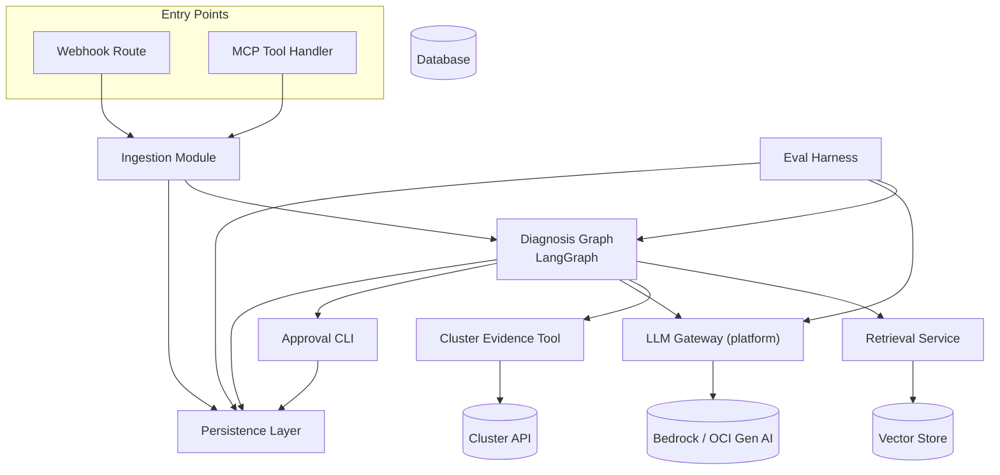

# Components

## Ingestion Module

**Responsibility:** The single front door for both entry points (webhook + MCP). Verifies request authenticity (NFR9), scrubs PII (FR10), deduplicates/interval-merges alerts (FR2, Story 3.2), persists the `Alert` record, then hands off to the Diagnosis Graph. Dedup is enforced atomically by the database (`external_alert_id UNIQUE` + `INSERT ... ON CONFLICT DO NOTHING`, see Database Schema) rather than a read-then-write check in application code — this closes the race condition where two near-simultaneous duplicate deliveries could otherwise both pass a "does it exist?" check before either insert completes.

**Key Interfaces:**
- `POST /webhook/alert` (FastAPI route)
- `ingest_alert(payload) -> Alert` (internal function also called by the MCP handler, so webhook and MCP never duplicate this logic)

**Dependencies:** Persistence Layer (writes `Alert`), Diagnosis Graph (hands off after ingestion)

**Technology Stack:** FastAPI route handler; `hmac`/`hashlib` (stdlib) for signature verification; no external dependency needed for PII scrubbing at this scale (regex/rule-based scrubber, not an ML service — flagged below)

## Diagnosis Graph

**Responsibility:** The LangGraph state machine itself — classify, retrieve, investigate, propose, human-approval nodes (Story 2.2). Owns `PipelineRun` lifecycle and produces `DiagnosisProposal`.

**Key Interfaces:**
- `run_pipeline(alert: Alert) -> PipelineRun` - the one entry point both the webhook path and the MCP tool call into (PRD Story 5.2 AC1 requires this: no duplicated business logic)

**Dependencies:** Retrieval Service (retrieve node), Cluster Evidence Tool (investigate node), LLM Gateway (propose node), Approval CLI (human-approval node), Persistence Layer (logs transitions, writes `DiagnosisProposal`)

**Technology Stack:** LangGraph 1.2.14

## Retrieval Service

**Responsibility:** The single seam (NFR8) between the graph and whatever vector store is active. Owns runbook corpus management and the retrieve node's similarity search.

**Key Interfaces:**
- `retrieve_runbook(alert: Alert) -> Runbook | None` (returns `None` on low-confidence match, per Story 2.1 AC3)
- `index_runbook(runbook: Runbook) -> None` (corpus management, Story 1.3)

**Dependencies:** Vector store (Chroma now, Oracle DB 23ai post-Story 5.1) — accessed *only* through this module, nothing else imports the vector store client directly

**Technology Stack:** chromadb 1.5.8 (MVP); swapped internally at Story 5.1

## Cluster Evidence Tool

**Responsibility:** Strictly read-only `kubectl get`/`describe` calls against the target cluster (Story 2.3). This module's entire reason to exist is to make NFR5 ("no action-executor exists") visible in the codebase: it physically cannot issue a write call because it has no method that does.

**Key Interfaces:**
- `get_evidence(alert: Alert) -> ClusterEvidence | None` (returns `None` + logs a flag on timeout/failure, per Story 2.3 AC4 — never raises up to fail the whole pipeline)

**Dependencies:** Target cluster (kind for dev/test, OKE for deployed) via the Kubernetes API

**Technology Stack:** `kubernetes` (official Python client) 31.x — read-only API calls only; this module's test suite should assert at import-time that no write/patch/delete method is referenced anywhere in it (a cheap static guard for NFR5)

## LLM Gateway (platform)

**Responsibility:** The other single seam (NFR1). Every LLM call — triage summary, LLM-judge, anything — goes through here. Owns rate limiting (token-bucket), response caching (LRU), provider selection (Bedrock pre-S13, OCI Gen AI post-S13), and emits traces.

**Key Interfaces:**
- `complete(prompt, model_config) -> LLMResponse` - the only method any other component may call to reach a model

**Dependencies:** AWS Bedrock (boto3) pre-S13 / OCI Gen AI post-S13; Langfuse (emits trace per call)

**Technology Stack:** boto3 1.43.100; Langfuse SDK; this is the component that lives in `platform/`, not `apps/incident-copilot/`, since M2–M6 depend on it directly

## Approval CLI

**Responsibility:** The real human-approval gate (Story 3.3) — displays a `DiagnosisProposal` with its evidence, records the `ApprovalDecision`, and is the only thing that can move a pipeline run from "proposed" to "approved/rejected."

**Key Interfaces:**
- CLI command (e.g., `copilot approve <proposal_id>` / `copilot reject <proposal_id>`)
- `record_decision(proposal_id, actor, decision) -> ApprovalDecision`

**Dependencies:** Persistence Layer (reads `DiagnosisProposal`, writes `ApprovalDecision`)

**Technology Stack:** Plain Python CLI (e.g., `typer` or stdlib `argparse` — no framework decision forced yet; Dev can pick at Story 3.3, this is intentionally left loose since it's low-risk)

## Eval Harness

**Responsibility:** Runs the fixed 20-incident synthetic set end-to-end through the same `run_pipeline` entry point as production, scores retrieval hit-rate + LLM-judge usefulness, and persists an `EvalRun`. Also the thing Story 4.2 invokes from CI.

**Key Interfaces:**
- `run_eval(incident_set) -> EvalRun`
- CLI entry point (`copilot eval`) so it's runnable identically by a human and by CI

**Dependencies:** Diagnosis Graph (runs the same pipeline, not a parallel implementation), LLM Gateway (judge calls)

**Technology Stack:** pytest-compatible but intentionally not *just* a pytest suite — it produces a persisted report artifact (PRD Story 3.4 AC4), so it's a standalone script/module that CI also happens to invoke

## Persistence Layer

**Responsibility:** Repository-pattern access to the six data models. Nothing in the app issues raw queries outside this layer.

**Key Interfaces:**
- One repository class per model (`AlertRepository`, `RunbookRepository`, `PipelineRunRepository`, `DiagnosisProposalRepository`, `ApprovalDecisionRepository`, `EvalRunRepository`)

**Dependencies:** Database (choice made in the next section, Database Schema)

**Technology Stack:** TBD next section

## Component Diagram

---

**⚠️ Elicitation required before continuing.**

Rationale / flags:
- PII scrubbing in the Ingestion Module is rule/regex-based, not an ML service — flagged explicitly because "PII scrubbed" (FR10) could mean something much heavier; for a 10-runbook, simulated-alert MVP I think regex-based (IPs, emails, common secret patterns) is the right-sized answer, but it's a real scope decision.
- Cluster Evidence Tool's "static guard" idea (test asserting no write methods are referenced) is a concrete technique for proving NFR5 in CI, not just in code review — new idea, not from the PRD, worth confirming you want that level of enforcement.
- Approval CLI's framework choice is deliberately left open — not every decision needs to be pinned now.
- Persistence Layer's actual technology is deferred to the next section on purpose (Database Schema should drive this, not the reverse).

Select 1-9 or just type your question/feedback:

1. Proceed to next section (skipping External APIs — Bedrock/OCI Gen AI and the Kubernetes API are already covered under Tech Stack/Components, not separate third-party integrations needing their own section — moving to Core Workflows)
2. Expand on the PII-scrubbing scope question — regex-based vs. something more robust
3. Challenge from a different stakeholder's perspective (e.g., a security reviewer evaluating the NFR5 static-guard idea)
4. Analyze what could go wrong if the Eval Harness's "same run_pipeline entry point" assumption breaks because eval needs deterministic/mocked LLM responses
5. Identify hidden assumptions in Retrieval Service being the only Chroma/DB23ai consumer
6. Red Team: argue the Ingestion Module should be split into separate Auth/Dedup/PII components rather than one module
7. Tree of Thoughts: 3 alternative component boundaries, compared
8. Self-Consistency check: re-derive the components independently from the PRD's epics and diff
9. Meta-review: critique this component breakdown as if you were Dev about to scaffold the `apps/incident-copilot/` package layout
