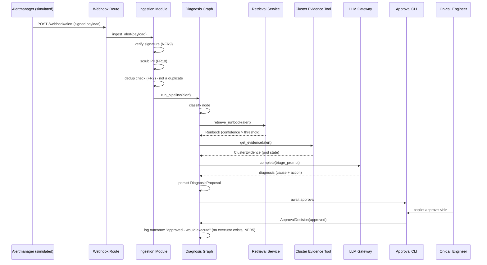

# Core Workflows

**Note on External APIs section:** Skipped as a separate template section — Bedrock/OCI Gen AI and the Kubernetes API are already fully specified under Tech Stack and Components above; a separate section would just repeat them.

## Workflow 1: Happy Path — Alert to Approved Action



## Workflow 2: Degraded & Rejected Paths

```mermaid
sequenceDiagram
    participant AM as Alertmanager (simulated)
    participant ING as Ingestion Module
    participant GRAPH as Diagnosis Graph
    participant TOOL as Cluster Evidence Tool
    participant OP as On-call Engineer

    Note over AM,ING: Case A - duplicate delivery (incl. concurrent/racing retries)
    AM->>ING: POST alert (same alert_id, retry)
    ING->>ING: INSERT ... ON CONFLICT (external_alert_id) DO NOTHING
    ING->>ING: 0 rows inserted -> duplicate; no second pipeline run triggered
    ING-->>AM: 202 Accepted (status: deduplicated)

    Note over GRAPH,TOOL: Case B - kubectl tool failure
    GRAPH->>TOOL: get_evidence(alert)
    TOOL--xGRAPH: timeout / API error
    GRAPH->>GRAPH: proceed with grounded_in_live_state=False (Story 2.3 AC4)
    GRAPH->>GRAPH: diagnosis proceeds from runbook text only, clearly flagged

    Note over GRAPH,OP: Case C - rejection
    GRAPH->>OP: present proposal (flagged: not grounded in live state)
    OP->>GRAPH: reject
    GRAPH->>GRAPH: log ApprovalDecision(rejected) - run ends as no-op (FR6)
```

---

**⚠️ Elicitation required before continuing.**

Rationale / flags:
- Workflow 1 ends at "approved — would execute," not an actual execution — consistent with the PRD's Story 3.3 AC2 and NFR5 (no executor module exists). Worth double-checking this doesn't read as broken/incomplete to someone seeing the diagram cold; I think the explicit log message handles that, but it's a judgment call.
- Workflow 2 bundles three distinct degraded cases into one diagram for compactness rather than three separate diagrams — tell me if you'd rather see them split out, e.g. for direct reuse in Story 2.3's test-design later.
- I didn't diagram the MCP tool path (Story 5.2) separately — it's identical to Workflow 1 from `ING` onward, just entering through `MCPH` instead of `WH`, per the Components section's explicit "no duplicated logic" requirement, so a second diagram would be redundant.

Select 1-9 or just type your question/feedback:

1. Proceed to next section (REST API Spec)
2. Expand on whether "approved — would execute" needs a more visible / different signal than a log line
3. Challenge from a different stakeholder's perspective (e.g., QA designing test cases directly from these sequence diagrams)
4. Analyze what could go wrong if two near-duplicate alerts arrive within milliseconds of each other (race condition in dedup check)
5. Identify hidden assumptions in Case B's "proceed with grounded_in_live_state=False" — does the LLM prompt actually change in this case, or just a flag gets set?
6. Red Team: argue Workflow 2's three cases should be separate diagrams for clarity
7. Tree of Thoughts: 3 alternative ways to signal "approved but nothing actually executed" to the approver
8. Self-Consistency check: re-derive these workflows independently from the Epic 2/3 stories and diff
9. Meta-review: critique these workflows as if you were Dev about to implement Story 2.2's graph wiring
