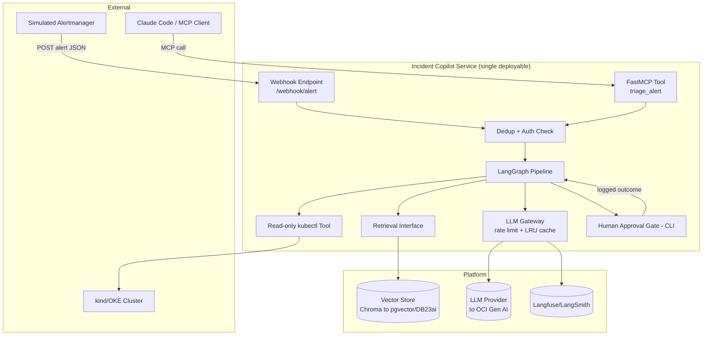

# High Level Architecture

## Technical Summary

Incident Copilot is a modular-monolith Python/FastAPI service orchestrating a LangGraph state machine (classify → retrieve → investigate → propose → human-approval) that turns a simulated Prometheus alert into an evidence-grounded diagnosis, gated behind explicit human approval. All model calls route through one internal LLM Gateway (rate-limited, cached) and all vector retrieval routes through one Retrieval interface — both are deliberately thin seams so Epic 5 can swap providers (OCI Gen AI, Oracle DB 23ai) behind them without touching call sites. The service is containerized and deployed via GitOps (Terraform + ArgoCD) to a real cluster, with every LLM call traced and a CI-gated eval harness enforcing a quality floor. This directly supports the PRD's dual goal: a trustworthy, demoable incident-diagnosis product, and a reusable platform (gateway, eval harness, deploy template) for the five products that follow it.

## High Level Overview

1. **Architectural style:** Modular Monolith, LangGraph-orchestrated (per PRD Technical Assumptions) — one deployable unit, internally organized into clearly-seamed modules (gateway, retrieval, graph, tools, approval) rather than separate network services.
2. **Repository structure:** Monorepo (per PRD) — `apps/incident-copilot/` for product code, `platform/` for the gateway/tracing/deploy pieces meant for reuse by M2–M6, `docs/` for BMad artifacts.
3. **Service architecture:** Single FastAPI process exposing two entry points (HTTP webhook, FastMCP tool) that both call into the same LangGraph pipeline — no duplicated business logic between transports (PRD Story 5.2 AC1).
4. **Primary data flow:** `Alert (webhook or MCP) → dedup/auth check → classify node → retrieve node (vector search) → investigate node (read-only kubectl) → propose node (LLM call via gateway) → human-approval node (CLI) → logged outcome`. Every node transition is logged for replay (PRD Story 2.2 AC4).
5. **Key decisions and rationale:**
   - **Single gateway/retrieval seams (NFR1/NFR8):** chosen specifically because Epic 5 must prove these abstractions hold under a real provider swap — this is a testable architectural commitment, not just good taste.
   - **No action-executor module exists at all (NFR5):** the human-approval node's "approve" path has no code path to a mutating action — there is nothing to bypass, because there is nothing to call. This satisfies "no autofix" architecturally, not just via a UI gate.
   - **CLI as the approval transport for MVP:** avoids taking on a Slack/Telegram integration (explicitly deferred) before the core loop is proven.

## High Level Project Diagram

## Architectural and Design Patterns

- **Gateway Pattern (LLM Gateway):** A single internal module mediates every call to an LLM provider, applying rate limiting and caching uniformly. *Rationale:* directly required by NFR1; it's also the exact seam Epic 5's provider swap tests, and the seam M2–M6 will depend on as a shared platform piece.
- **Repository Pattern (Retrieval Interface):** Vector store access goes through one interface, never called ad hoc. *Rationale:* required by NFR8; makes the Chroma→pgvector/DB23ai migration (Story 5.1) a swap of one implementation, not a grep-and-replace across the codebase.
- **State Machine / Orchestrator (LangGraph):** The diagnosis pipeline is an explicit graph of nodes with inspectable state, not a single function with branching logic. *Rationale:* required by PRD Story 2.2; makes each stage unit-testable and the whole run replayable from logs.
- **Hexagonal-lite boundary around external I/O:** `kubectl` calls, LLM calls, and vector store calls are each isolated behind their own module boundary (tool/gateway/retrieval), with the graph nodes depending on interfaces, not concrete clients. *Rationale:* this is what makes NFR1/NFR8/NFR5 enforceable by code structure rather than by convention alone.

I considered and rejected **Event-Driven (pub/sub) decomposition** for M1 — queueing alerts through SQS/EventBridge-equivalent before processing. That pattern is explicitly scheduled for **M2 (PipelineMedic, Story P3)** where async webhook processing is a named requirement; introducing it here would be solving a scale problem M1 doesn't have yet (single alert, single pipeline run, synchronous human approval) — Progressive Complexity, per the RFC's own stated philosophy.

---

**⚠️ Elicitation required before continuing.**

Rationale / flags:
- The diagram shows MCP and webhook both landing on the same Dedup+Auth check — worth confirming you want NFR9's signature verification applied to the MCP path too, or only the HTTP webhook (RFC/PRD are written assuming HTTP webhook auth; MCP auth semantics differ by transport, so this may need its own answer in the Security section later).
- "No action-executor module exists at all" is my strongest architectural interpretation of NFR5 — it means Epic 5/M2+ can't casually add real remediation without a deliberate new epic and a new PRD/architecture decision, which is intentional friction.

Select 1-9 or just type your question/feedback:

1. Proceed to next section (Tech Stack)
2. Expand on MCP-path authentication — should it mirror HMAC or use a different mechanism
3. Challenge from a different stakeholder's perspective (e.g., a security reviewer auditing both entry points)
4. Analyze what could go wrong with "no action-executor exists" once M2 reuses this agent core and does need to post PR comments (a real write action)
5. Identify hidden assumptions in treating webhook and MCP as symmetric entry points
6. Red Team: argue for an event-driven queue now, since 5 more products are coming and will need it anyway
7. Tree of Thoughts: 3 alternative high-level diagrams, compared
8. Self-Consistency check: re-derive the architectural patterns independently from the PRD's Technical Assumptions and diff
9. Meta-review: critique this section as if you were Dev about to implement the LangGraph skeleton (Story 2.2)
